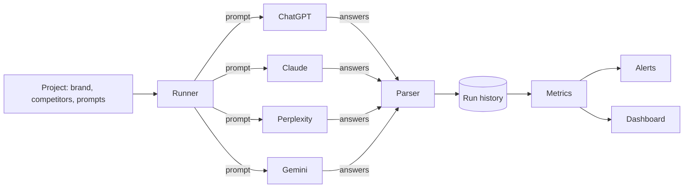

# Architecture — agent-visibility

## 1. Scope
Track how AI agents and assistants recommend a brand: mentions, rank, sentiment, citations, over time.
**MVP:** project config, `Platform` interface + deterministic `MockPlatform`, answer parser
(alias-aware word-boundary mentions, list rank with first-mention fallback, windowed sentiment,
citation domains), metrics per platform and overall, JSONL history, regression alerts.
**Product:** real adapters (APIs + browser capture), prompt discovery, scheduled runs, gap analysis.

## 2. System context

## 3. Metrics
- mention rate = answers mentioning the brand / answers
- share of voice = brand mentions / all tracked-entity mentions
- avg rank, top-3 rate, mean sentiment (−1..1), top cited domains
- alerts vs. the previous run: dropped out of the top 3, share of voice fell ≥ 5 points, no longer mentioned

## 4. Design decisions
- **Platform adapters behind one method** (`ask(prompt) -> str`). New assistants are a single class.
- **A deterministic mock** makes the whole pipeline testable without API keys or flaky outputs.
- **Word-boundary + alias matching** avoids "Pipelyx" counting as "Pipely".
- **Store raw parsed rows, compute metrics on read.** Metric definitions can evolve and history is recomputed.

## 5. Production architecture
A scheduler (daily per project × platform × prompt; n samples per prompt to average out
stochastic answers), a worker pool with per-provider rate limits, Postgres or ClickHouse for runs,
and a dashboard with trend charts and alert channels.

## 6. Risks
Answer variance (sample multiple times, report confidence intervals). Consumer apps differ from
APIs (personalisation, browsing), so browser-based capture is needed for fidelity.
